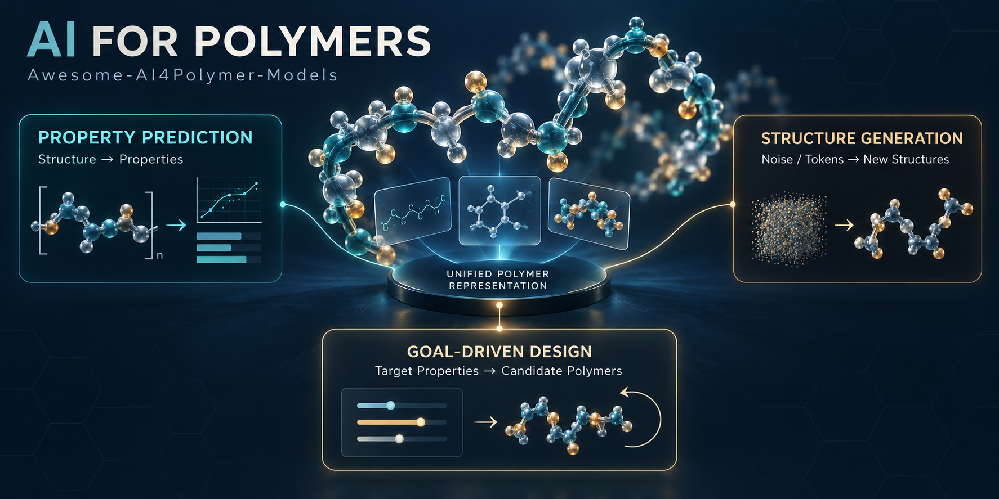

# Awesome-AI4Polymer-Models

> Representative AI models for polymer property prediction, inverse design, and unified modeling.

聚合物领域代表性 AI 模型索引：以用户提供的 Table 1 图片为初始范围，补充论文、作者代码与模型发布入口。本版收录 **22 个模型**，按原图的主要下游能力分组。

**最近核查：2026-10-14** · [JSON](data/models.json) · [CSV](data/models.csv) · [原图字段与核查记录](docs/verification.md) · [架构图集](figures/README.md) · [贡献指南](CONTRIBUTING.md)

覆盖：性质预测 **14** 个，逆向设计 **4** 个，预测与设计统一 **4** 个。

## 导航

- [性质预测](#property-prediction)
- [逆向设计](#inverse-design)
- [预测与设计统一](#unified-prediction-design)
- [逐项文献与备注](#model-notes)
- [读表说明](#reading-guide)
- [22 个模型的架构图](figures/README.md)

## 读表说明

**年份、应用证据、模态、架构与预训练方法沿用原图**；它们不是本仓库对每篇全文的独立审计结论。已核查的差异和补充信息放在条目备注与 [核查记录](docs/verification.md)，原始值另存于 JSON 的 `source_table`。

- **B**：留出基准评估；**S**：代理模型/性质 oracle 评估；**Sim**：物理计算验证；**E**：前瞻合成或实验测量。
- **CL**：对比学习；**PL**：预测学习；**GL**：原图的生成学习标签。GL 也覆盖 MLM 等训练目标，并不意味着模型能直接进行聚合物生成。
- **—**：原图未给出；不是“没有预训练”。**多领域预测**表示多个性质类别，不代表所有性质都被验证。
- **作者代码/模型**表示定位到作者关联的入口；未运行第三方代码或验证权重与结果。**代码未定位**不等于未开源。
- 通用分子模型及从小分子迁移的模型也按原图保留，具体范围见条目备注；本列表不对 foundation model 的定义作统一背书。

## 性质预测 · Property Prediction

| 模型 | 年份 | 应用 [证据] | 模态 | 架构（原图） | 方法（原图） | 资源 |
| --- | --- | --- | --- | --- | --- | --- |
| [polyBERT](#polybert) | 2023 | Multidomain prediction [B] | Sequence | DeBERTa | GL | [论文](https://www.nature.com/articles/s41467-023-39868-6) · [作者代码](https://github.com/Ramprasad-Group/polyBERT) · [模型](https://huggingface.co/kuelumbus/polyBERT) · [架构图](figures/polyBERT.png) |
| [TransPolymer](#transpolymer) | 2023 | Multidomain prediction [B] | Sequence | RoBERTa | GL | [论文](https://arxiv.org/abs/2209.01307) · [作者代码](https://github.com/ChangwenXu98/TransPolymer) · [模型](https://huggingface.co/ChangwenXu/TransPolymer) · [架构图](figures/TransPolymer.png) |
| [SML-MT](#sml-mt) | 2023 | Electronic and optical prediction [B] | Sequence | BERT | GL | [论文](https://arxiv.org/abs/2310.16958) · 代码未定位 · [架构图](figures/SML-MT.png) |
| [SPG-TED289M](#spg-ted289m) | 2024 | Thermal, optical, membrane, and electrolyte prediction [B] | Sequence | BERT | GL | [论文](https://research.ibm.com/publications/a-large-encoder-decoder-polymer-based-foundation-model) · 代码未定位 · [架构图](figures/SPG-TED289M.png) |
| [PolyCL](#polycl) | 2025 | Electronic and optical prediction [B] | Sequence | DeBERTa | CL | [论文](https://pubs.rsc.org/en/content/articlelanding/2025/dd/d4dd00236a) · [作者代码](https://github.com/JiajunZhou96/PolyCL) · [架构图](figures/PolyCL.png) |
| [Trinity](#trinity) | 2025 | Flammability prediction [B] | Sequence | MoLFormer | — | [论文](https://www.nature.com/articles/s43588-025-00768-y) · [作者代码](https://github.com/ningliu-iga/TrinityLLM) · [架构图](figures/Trinity.png) |
| [MHG-GNN](#mhg-gnn) | 2023 | Multidomain prediction [B] | Graph | GIN, MHG | GL | [论文](https://arxiv.org/abs/2309.16374) · [相关作者实现](https://github.com/IBM/materials) · [模型](https://huggingface.co/ibm-research/materials.mhg-ged) · [架构图](figures/MHG-GNN.png) |
| [Polymer-JEPA](#polymer-jepa) | 2026 | Electron-affinity and phase prediction [B] | Graph | JEPA | PL | [论文](https://pubs.rsc.org/en/content/articlelanding/2026/dd/d5dd00308c) · [作者代码](https://github.com/Intelligent-molecular-systems/Polymer-JEPA) · [架构图](figures/Polymer-JEPA.png) |
| [MMPolymer](#mmpolymer) | 2024 | Multidomain prediction [B] | Sequence, 3D | RoBERTa, SE(3)-Transformer | GL, CL, denoising | [论文](https://arxiv.org/abs/2406.04727) · [作者代码](https://github.com/FanmengWang/MMPolymer) · [架构图](figures/MMPolymer.png) |
| [PolyNC](#polync) | 2024 | Property prediction [B]; Tg validation [E] | Sequence, Text | Text+Chem T5 | — | [论文](https://pubs.rsc.org/en/content/articlelanding/2024/sc/d3sc05079c) · [作者代码](https://github.com/HKQiu/Unified_ML4Polymers) · [模型](https://huggingface.co/hkqiu/PolyNC) · [架构图](figures/PolyNC.png) |
| [MIPS](#mips) | 2025 | Multidomain prediction [B] | Graph, 3D | Graphormer | GL, multimodal learning | [论文](https://arxiv.org/abs/2507.20326) · [作者代码](https://github.com/wjxts/MIPS) · [架构图](figures/MIPS.png) |
| [PolyLLMem](#polyllmem) | 2025 | Multidomain prediction [B] | Sequence, Text, 3D | Llama, Uni-Mol | — | [论文](https://arxiv.org/abs/2503.22962) · [作者链接（内容待核实）](https://github.com/zhangtr10/PolyLLMem) · [架构图](figures/PolyLLMem.png) |
| [STR-Bamba](#str-bamba) | 2025 | Multidomain prediction [B] | Sequence, Text | Bamba | GL, PL | [论文](https://openreview.net/pdf?id=0uWNuJ1xtz) · [作者代码](https://github.com/IBM/materials/tree/main/models/str_bamba) · [模型](https://huggingface.co/ibm-research/materials.str-bamba) · [架构图](figures/STR-Bamba.png) |
| [Uni-Poly](#uni-poly) | 2025 | Thermal, density, and resistivity prediction [B] | Sequence, Text, Graph, 3D | ChemBERTa, GIN, Text+Chem T5, SchNet | Multimodal learning | [论文](https://www.nature.com/articles/s41524-025-01652-z) · [作者链接（访问失败）](https://github.com/huang-qi/Uni-Poly) · [架构图](figures/Uni-Poly.png) |

## 逆向设计 · Inverse Design

| 模型 | 年份 | 应用 [证据] | 模态 | 架构（原图） | 方法（原图） | 资源 |
| --- | --- | --- | --- | --- | --- | --- |
| [PolyRL](#polyrl) | 2026 | Gas-separation design [S, Sim] | Sequence | GPT-2, Llama-2 | GL | [论文](https://pubs.rsc.org/en/content/articlelanding/2026/dd/d5dd00272a) · [作者代码](https://github.com/Knitua/PolyRL) · [架构图](figures/PolyRL.png) |
| [PolyTAO](#polytao) | 2024 | Property-conditioned generation [S] | Sequence, Text | Text+Chem T5 | GL (structure-property) | [论文](https://www.nature.com/articles/s41524-024-01466-5) · [作者代码](https://github.com/hkqiu/PolymerGenerationPretrainedModel) · [模型](https://huggingface.co/hkqiu/PolymerGenerationPretrainedModel) · [架构图](figures/PolyTAO.png) |
| [DemoDiff](#demodiff) | 2025 | In-context design [S] | Graph | GraphDiT | GL (task-context) | [论文](https://arxiv.org/abs/2510.08744) · [作者代码](https://github.com/liugangcode/DemoDiff) · [模型](https://huggingface.co/liuganghuggingface/DemoDiff-0.7B) · [架构图](figures/DemoDiff.png) |
| [CoMole](#comole) | 2026 | Property-conditioned generation [S] | Graph | GraphDiT | Denoising | [论文](https://arxiv.org/abs/2605.15354) · 代码未定位 · [架构图](figures/CoMole.png) |

## 预测与设计统一 · Unified Prediction and Design

| 模型 | 年份 | 应用 [证据] | 模态 | 架构（原图） | 方法（原图） | 资源 |
| --- | --- | --- | --- | --- | --- | --- |
| [polyBART](#polybart) | 2025 | Property prediction [B]; inverse design [S, E] | Sequence | SELFIES-TED | Denoising | [论文](https://aclanthology.org/2025.findings-emnlp.647/) · 代码未定位 · [架构图](figures/polyBART.png) |
| [POLYT5](#polyt5) | 2026 | Property prediction [B]; dielectric design [S, Sim, E] | Sequence | T5 | GL | [论文](https://www.nature.com/articles/s44387-026-00087-1) · 代码未定位 · [架构图](figures/POLYT5.png) |
| [PolyConFM](#polyconfm) | 2025 | Property prediction [B]; conformation generation [B]; polymer design [S] | Sequence, 3D | MolCLR, Uni-Mol, GraphDiT | GL | [论文](https://arxiv.org/abs/2510.16023) · [作者代码](https://github.com/FanmengWang/PolyConFM) · [架构图](figures/PolyConFM.png) |
| [Llamole](#llamole) | 2025 | Molecular design [S]; retrosynthesis [B] | Text, Graph | GraphDiT, GNN | Denoising, CL, reaction-template supervision | [论文](https://arxiv.org/abs/2410.04223) · [作者代码](https://github.com/liugangcode/Llamole) · [架构图](figures/Llamole.png) |

## 逐项文献与备注

### polyBERT

**[polyBERT: a chemical language model to enable fully machine-driven ultrafast polymer informatics](https://www.nature.com/articles/s41467-023-39868-6)** · Nature Communications · 2023

从 PSMILES 学习聚合物指纹，再结合多任务预测头预测多类性质。

**预训练语料（原图）：** Augmented from 13k real polymers (100M)。

**核查备注：** 原图 100M 指假想结构语料；论文从 13,766 个已知聚合物的片段重组生成 100M PSMILES。方法实际为掩码语言建模（MLM）。

### TransPolymer

**[TransPolymer: a Transformer-based language model for polymer property predictions](https://arxiv.org/abs/2209.01307)** · npj Computational Materials · 2023

使用化学感知分词与掩码预训练，微调预测电学、光学、电解质等性质。

**预训练语料（原图）：** PI1M (1M)。

**核查备注：** 作者仓库注明 PI1M 原始约 1M，五倍增强后约 5M 序列；不要将这两个规模混用。

### SML-MT

**[Transferring a Molecular Foundation Model for Polymer Property Predictions](https://arxiv.org/abs/2310.16958)** · Journal of Chemical Information and Modeling · 2023

将小分子预训练表示迁移到聚合物性质预测，研究跨化学空间的迁移学习。

**预训练语料（原图）：** Enamine (1M)。

**核查备注：** 规模存在实质差异：原图 Enamine 1M；作者稿明确为约 1 billion（1B，10亿）Enamine REAL 小分子。代码未定位。

补充来源：[来源 1](https://www.osti.gov/servlets/purl/2282951) · [来源 2](https://doi.org/10.1021/acs.jcim.3c01650)

### SPG-TED289M

**[A Large Encoder-Decoder Polymer-Based Foundation Model](https://research.ibm.com/publications/a-large-encoder-decoder-polymer-based-foundation-model)** · NeurIPS 2024 AI4Mat workshop · 2024

基于 serialized polymer graph（SPG）序列表示进行预训练，支持多类聚合物预测任务。

**预训练语料（原图）：** Polymers from open literature (1M)。

**核查备注：** IBM 官方摘要称其为 encoder-decoder，约 1M SPG 样本；原图 BERT 是简化架构标签。未定位专属代码/权重，不能用 SMI-TED 替代。

补充来源：[来源 1](https://openreview.net/pdf?id=L47GThI95d)

### PolyCL

**[PolyCL: contrastive learning for polymer representation learning via explicit and implicit augmentations](https://pubs.rsc.org/en/content/articlelanding/2025/dd/d4dd00236a)** · Digital Discovery · 2025

通过显式与隐式增强进行对比学习，获得可迁移的聚合物表示。

**预训练语料（原图）：** PI1M (1M)。

**核查备注：** 2025 是期刊卷期年；RSC 标示首次在线发表为 2024-11-28。代码指向聚合物 PolyCL，避免误连同名医学图像项目。

### Trinity

**[Harnessing large language models for data-scarce learning of polymer properties](https://www.nature.com/articles/s43588-025-00768-y)** · Nature Computational Science · 2025

利用物理模型生成的合成数据先训练，再用有限实验数据微调，预测聚合物燃烧性能。

**预训练语料（原图）：** —。

**核查备注：** 作者代码项目名 TrinityLLM。原图预训练两列为空，不表示模型没有预训练；作者仓库说明使用 MoLFormer，并采用物理合成数据与实验数据两阶段训练。

补充来源：[来源 1](https://arxiv.org/abs/2407.02770)

### MHG-GNN

**[MHG-GNN: Combination of Molecular Hypergraph Grammar with Graph Neural Network](https://arxiv.org/abs/2309.16374)** · NeurIPS 2023 AI4Mat workshop · 2023

结合分子超图语法与图神经网络的自编码器，包含聚合物性质预测应用。

**预训练语料（原图）：** PubChem (1.3M)。

**核查备注：** 通用材料/分子表示模型。IBM 当前发布入口使用 MHG-GED 命名，列为相关实现入口，不声称与原论文版本完全相同。

### Polymer-JEPA

**[Joint embedding predictive architecture for self-supervised pretraining on polymer molecular graphs](https://pubs.rsc.org/en/content/articlelanding/2026/dd/d5dd00308c)** · Digital Discovery · 2026

在聚合物图的潜在空间进行自监督预测，面向标签稀缺的性质学习。

**预训练语料（原图）：** Copolymer dataset (43k)。

**核查备注：** 原图采用 2026 期刊年；预印本首发于 2025。作者仓库包含 GNN 与 Transformer 编码器版本，推荐的 v2 使用 GNN。43k 规模保留原图口径。

补充来源：[来源 1](https://arxiv.org/abs/2506.18194) · [来源 2](https://doi.org/10.5281/zenodo.17630815)

### MMPolymer

**[MMPolymer: A Multimodal Multitask Pretraining Framework for Polymer Property Prediction](https://arxiv.org/abs/2406.04727)** · CIKM · 2024

联合 1D 序列与 3D 结构，通过掩码恢复、坐标去噪及跨模态对齐进行预训练。

**预训练语料（原图）：** PI1M (1M)。

**核查备注：** 论文使用 Star Substitution 构造结构信息；这里的 3D 表示应按论文定义理解，不等同于实验测得的完整聚合物链构象。

### PolyNC

**[PolyNC: a natural and chemical language model for the prediction of unified polymer properties](https://pubs.rsc.org/en/content/articlelanding/2024/sc/d3sc05079c)** · Chemical Science · 2024

结合自然语言与化学语言，以统一任务格式预测聚合物性质，包含 Tg 实验验证。

**预训练语料（原图）：** —。

**核查备注：** 2024 为期刊卷期年。原图预训练数据及方法为空；不据此推断从零训练。

补充来源：[来源 1](https://pmc.ncbi.nlm.nih.gov/articles/PMC10763023/)

### MIPS

**[MIPS: a Multimodal Infinite Polymer Sequence Pre-training Framework for Polymer Property Prediction](https://arxiv.org/abs/2507.20326)** · ACM Multimedia · 2025

通过 star linking 表示无限重复聚合物序列，并融合拓扑与 3D 信息。

**预训练语料（原图）：** PI1M (1M)。

**核查备注：** Graphormer 为原图架构标签；论文重点是局部图注意力、主链嵌入与跨模态融合。

### PolyLLMem

**[Multimodal machine learning with large language embedding model for polymer property prediction](https://arxiv.org/abs/2503.22962)** · arXiv preprint · 2025

融合 Llama 3 文本嵌入与 Uni-Mol 结构嵌入，用 LoRA 调整后预测聚合物性质。

**预训练语料（原图）：** —。

**核查备注：** 原图预训练为空；论文使用已有 Llama 3 与 Uni-Mol 表示，不等于没有预训练。作者代码链接存在，但本次访问只看到仓库入口，未确认完整实现可用。

### STR-Bamba

**[STR-Bamba: Multimodal Molecular Textual Representation Encoder-Decoder Foundation Model](https://openreview.net/pdf?id=0uWNuJ1xtz)** · OpenReview manuscript · 2025

基于 Transformer 与 Mamba-2 混合架构，编码多种分子字符串与聚合物表示。

**预训练语料（原图）：** PubChem (117M); polymers from open literature (2M)。

**核查备注：** 原图 PubChem 117M；作者模型卡写约 118M 小分子、2M 聚合物及 258 个配方，另有 588M 多表示样本口径。GL/PL 标签保留原图，实际目标以原文为准。

### Uni-Poly

**[Unified multimodal multidomain polymer representation for property prediction](https://www.nature.com/articles/s41524-025-01652-z)** · npj Computational Materials · 2025

整合 SMILES、图、几何、指纹与领域文本，预测热学性质、密度及电阻率。

**预训练语料（原图）：** PolyInfo (15k)。

**核查备注：** 论文给出作者仓库 huang-qi/Uni-Poly，但本次网页访问返回 404；保留作者声明链接并标记访问失败。PolyInfo 数据需遵循 NIMS 使用条件。

补充来源：[来源 1](https://d-nb.info/1372505911/34)

### PolyRL

**[PolyRL: reinforcement learning-guided polymer generation for multi-objective polymer discovery](https://pubs.rsc.org/en/content/articlelanding/2026/dd/d5dd00272a)** · Digital Discovery · 2026

结合生成模型、性质奖励与强化学习，优化气体分离聚合物，并进行分子模拟验证。

**预训练语料（原图）：** Hypothetical polymers (1M)。

**核查备注：** 2026 是期刊卷期年，作者稿首次在线发表于 2025-11-25。作者仓库引用作者名单与出版页面不一致，引用请以出版商为准。

补充来源：[来源 1](https://doi.org/10.5281/zenodo.17498383) · [来源 2](https://doi.org/10.5281/zenodo.17498407)

### PolyTAO

**[On-demand reverse design of polymers with PolyTAO](https://www.nature.com/articles/s41524-024-01466-5)** · npj Computational Materials · 2024

从性质提示生成聚合物结构，支持半模板与无模板条件生成。

**预训练语料（原图）：** PI1M (1M)。

**核查备注：** 作者论文说明基于 PolyNC 初始权重训练；条件预训练使用约 1M 结构-性质对。原图 S 为代理性质评估。

补充来源：[来源 1](https://d-nb.info/1356348556/34)

### DemoDiff

**[Graph Diffusion Transformers are In-Context Molecular Designers](https://arxiv.org/abs/2510.08744)** · arXiv preprint · 2025

用分子-分数示例构成任务上下文，引导图扩散模型适应分子与材料设计任务。

**预训练语料（原图）：** PolyInfo, MSA。

**核查备注：** 通用分子模型，包含聚合物设计任务。原图只列 PolyInfo/MSA，论文语料覆盖药物与材料多来源；不能视为仅用聚合物预训练。

### CoMole

**[Controllable Molecular Generative Foundation Models](https://arxiv.org/abs/2605.15354)** · arXiv preprint · 2026

以 motif-aware 图扩散和强化学习实现可控生成，评估聚合物气体渗透与 DFT 性质。

**预训练语料（原图）：** Real polymers (13k)。

**核查备注：** 论文说明材料部分用约 13k 真实聚合物预训练，同时还有药物相关任务。架构及 Denoising 标签为原图概括；未定位官方代码链接。

补充来源：[来源 1](https://arxiv.org/html/2605.15354v2)

### polyBART

**[polyBART: A Chemical Linguist for Polymer Property Prediction and Generative Design](https://aclanthology.org/2025.findings-emnlp.647/)** · Findings of EMNLP · 2025

用 PSELFIES 适配分子语言模型，统一结构-性质翻译与聚合物生成，包含实验合成验证。

**预训练语料（原图）：** Genome, SMiPoly (200M), real polymers (13k)。

**核查备注：** 原图约 200M 是语料概括。正式论文附录列总语料 210,645,750；small 使用约 200M，large 使用 25M，规模取决于变体。未定位官方代码。

补充来源：[来源 1](https://arxiv.org/abs/2506.04233)

### POLYT5

**[POLYT5: an encoder-decoder foundation chemical language model for generative polymer design](https://www.nature.com/articles/s44387-026-00087-1)** · npj Artificial Intelligence · 2026

基于 T5 编码器-解码器，联合性质预测与目标性质条件生成，包含介电材料设计验证。

**预训练语料（原图）：** Hypothetical polymers (100M), real polymers (13k)。

**核查备注：** 预印本首发于 2025，正式期刊年为 2026。作者稿说明超过 100M 假想结构；Data availability 明确数据因机构考虑 IP 保护而未公开。未定位官方代码。

补充来源：[来源 1](https://arxiv.org/abs/2510.18860) · [来源 2](https://ramprasad.mse.gatech.edu/wp-content/uploads/2026/03/polyT5-Sahu_et_al-2026-npj_Artificial_Intelligence.pdf)

### PolyConFM

**[Unifying Polymer Modeling and Design via a Conformation-Centric Generative Foundation Model](https://arxiv.org/abs/2510.16023)** · arXiv preprint · 2025

以构象生成预训练连接聚合物建模、性质预测与条件设计。

**预训练语料（原图）：** 50k polymers with conformations。

**核查备注：** 论文介绍掩码自回归局部构象重建与方向变换。原图架构为组件概括；作者仓库标题采用 A Conformation-Centric Generative Foundation Model for Linear Polymer Modeling and Design。50k 规模为原图口径。

### Llamole

**[Multimodal Large Language Models for Inverse Molecular Design with Retrosynthetic Planning](https://arxiv.org/abs/2410.04223)** · ICLR · 2025

将 LLM 与图生成/预测模块结合，生成目标分子并进行逆合成规划。

**预训练语料（原图）：** Graph-text pairs (600k)。

**核查备注：** 属于通用分子设计与逆合成模型，不能据原图归类声称其已经验证聚合物专属逆合成。预印本为 2024，会议年为 2025；原图架构省略了基础 LLM。

## 来源与维护

初始范围来自用户提供的代表性聚合物基础模型 Table 1 截图。截图没有附原文题名、DOI 或参考文献表，因此不能还原其中的上标引用编号；本仓库根据模型名独立定位原始论文及作者发布资源。

主要来源为出版商、arXiv、会议官方档案和作者仓库。未找到的资源留空，访问失败单独标注。没有使用其他 Awesome 列表或自动生成摘要作为事实依据，也未对各论文做统一重跑或性能排名。

修改 `data/models.json` 后运行 `python3 scripts/build_catalog.py`，可更新本页、CSV 与核查记录。欢迎通过 Issue/PR 补充官方资源、修复链接或澄清原图差异。
