# 聚合物模型架构图

覆盖原始表中的 22 个模型：新生成 20 张，复用 2 张。
沿用 PolymerGeneration 项目的白底、深蓝标题、青色编码模块和橙色生成/预测模块风格。
新图使用内置 ImageGen，根据论文或作者公开资料重绘；这些图是架构示意，不是论文原图。

PolyTAO、POLYT5 从原项目直接复制，文件哈希保持一致，没有重复生成。
其余图已人工检查文字、分支和关键连线；图中省略的实现细节应以论文及作者代码为准。

SPG-TED289M、STR-Bamba、PolyRL 暂无可获取的本地全文，使用作者公开来源绘制概要，图内及下表单独标注。
来源页码按本地 PDF 的物理页序号（从 1 开始），不同版本可能不同。

[结构规格与来源](architecture_specs.json) · [可用提示词与文件校验](generation_manifest.json) · [模型资源索引](../README.md)

| 模型 | 图像 | 制作方式 | 依据 |
| --- | --- | --- | --- |
| polyBERT | [PNG](polyBERT.png) | 新生成 | 全文 |
| TransPolymer | [PNG](TransPolymer.png) | 新生成 | 全文 |
| SML-MT | [PNG](SML-MT.png) | 新生成 | 全文 |
| SPG-TED289M | [PNG](SPG-TED289M.png) | 新生成 | 作者公开资料概要 |
| PolyCL | [PNG](PolyCL.png) | 新生成 | 全文 |
| Trinity | [PNG](Trinity.png) | 新生成 | 全文 |
| MHG-GNN | [PNG](MHG-GNN.png) | 新生成 | 全文 |
| Polymer-JEPA | [PNG](Polymer-JEPA.png) | 新生成 | 全文 |
| MMPolymer | [PNG](MMPolymer.png) | 新生成 | 全文 |
| PolyNC | [PNG](PolyNC.png) | 新生成 | 全文 |
| MIPS | [PNG](MIPS.png) | 新生成 | 全文 |
| PolyLLMem | [PNG](PolyLLMem.png) | 新生成 | 全文 |
| STR-Bamba | [PNG](STR-Bamba.png) | 新生成 | 作者公开资料概要 |
| Uni-Poly | [PNG](Uni-Poly.png) | 新生成 | 全文 |
| PolyRL | [PNG](PolyRL.png) | 新生成 | 作者公开资料概要 |
| PolyTAO | [PNG](PolyTAO.png) | 复用原图 | 全文 |
| DemoDiff | [PNG](DemoDiff.png) | 新生成 | 全文 |
| CoMole | [PNG](CoMole.png) | 新生成 | 全文 |
| polyBART | [PNG](polyBART.png) | 新生成 | 全文 |
| POLYT5 | [PNG](POLYT5.png) | 复用原图 | 全文 |
| PolyConFM | [PNG](PolyConFM.png) | 新生成 | 全文 |
| Llamole | [PNG](Llamole.png) | 新生成 | 全文 |

## polyBERT

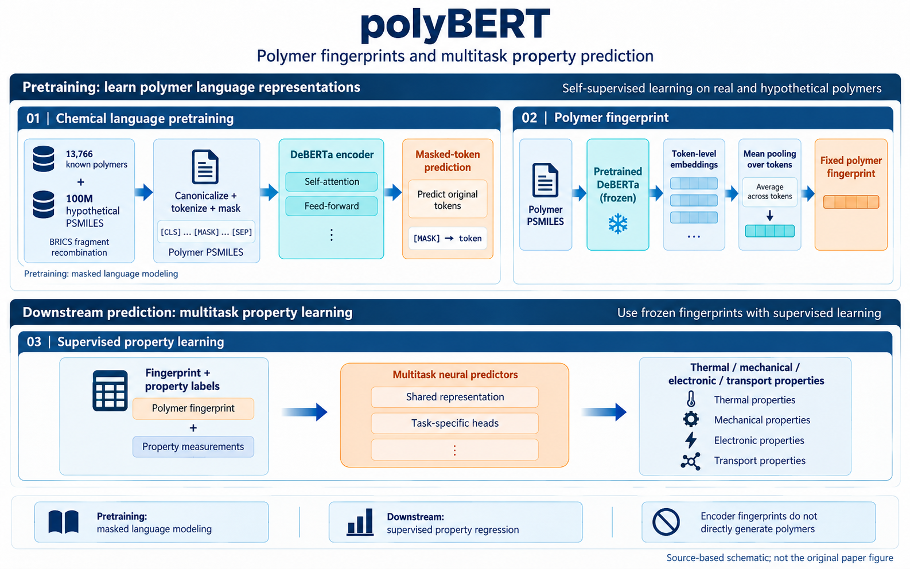

论文：[polyBERT: a chemical language model to enable fully machine-driven ultrafast polymer informatics](https://www.nature.com/articles/s41467-023-39868-6)

依据：本地 `polyBERT_2023_published.pdf`，PDF 第 2, 6, 7 页。

区分 MLM 预训练、冻结 encoder 指纹抽取、多任务神经性质预测；不把 encoder 当生成器。


## TransPolymer

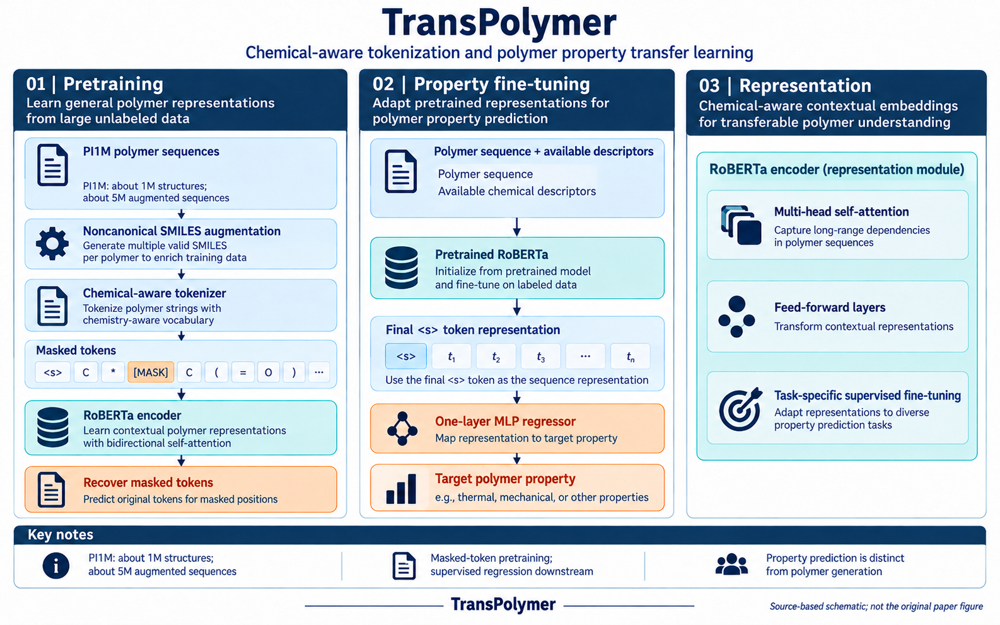

论文：[TransPolymer: a Transformer-based language model for polymer property predictions](https://arxiv.org/abs/2209.01307)

依据：本地 `TransPolymer_2023_published.pdf`，PDF 第 3, 12 页。

采用 RoBERTa 的 `<s>` 表示；化学描述符是输入元数据，不是选择性质的自然语言提示。已针对特殊 token 和例子文字做图像修正。


## SML-MT

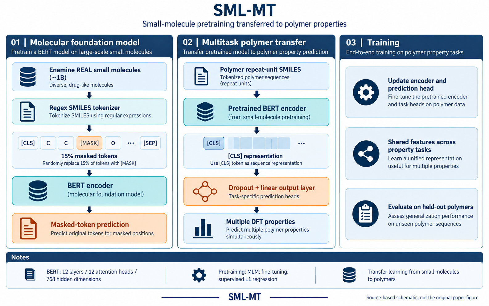

论文：[Transferring a Molecular Foundation Model for Polymer Property Predictions](https://arxiv.org/abs/2310.16958)

依据：本地 `SML-MT_2023_author_manuscript.pdf`，PDF 第 8, 9, 12 页。

Enamine 约 1B 小分子；BERT 的 [CLS] 表示接 dropout 和线性多任务输出；性质微调采用 L1。


## SPG-TED289M

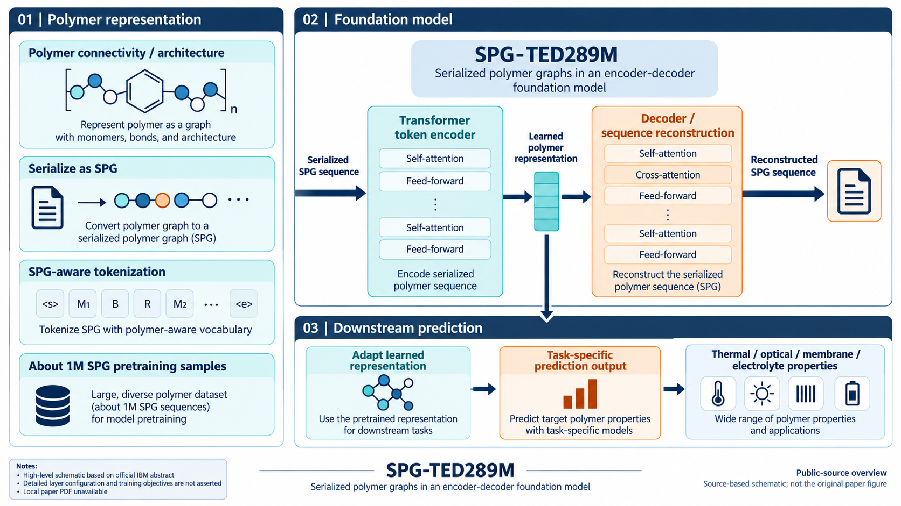

论文：[A Large Encoder-Decoder Polymer-Based Foundation Model](https://research.ibm.com/publications/a-large-encoder-decoder-polymer-based-foundation-model)

依据：作者公开资料概要；本地全文缺失，未确认的层数、参数和细节没有加入图中。

补充依据：[作者来源](https://research.ibm.com/publications/a-large-encoder-decoder-polymer-based-foundation-model)

仅绘制官方摘要支持的 SPG 序列、encoder-decoder、性质迁移的概要。无本地 PDF，不断言层数、精确损失或 head 结构。


## PolyCL

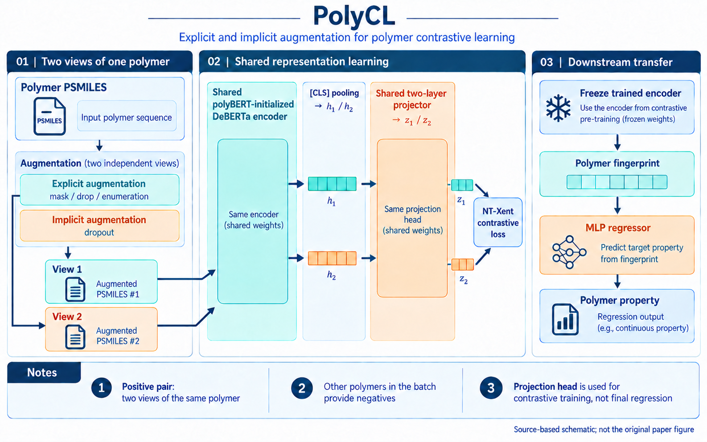

论文：[PolyCL: contrastive learning for polymer representation learning via explicit and implicit augmentations](https://pubs.rsc.org/en/content/articlelanding/2025/dd/d4dd00236a)

依据：本地 `PolyCL_2024_preprint.pdf`，PDF 第 6, 7, 8, 9 页。

共享 encoder / projector 的两条并行正例分支，NT-Xent 训练；下游冻结 encoder 并绕过 projector。已针对视图之间错误连线做图像修正。


## Trinity

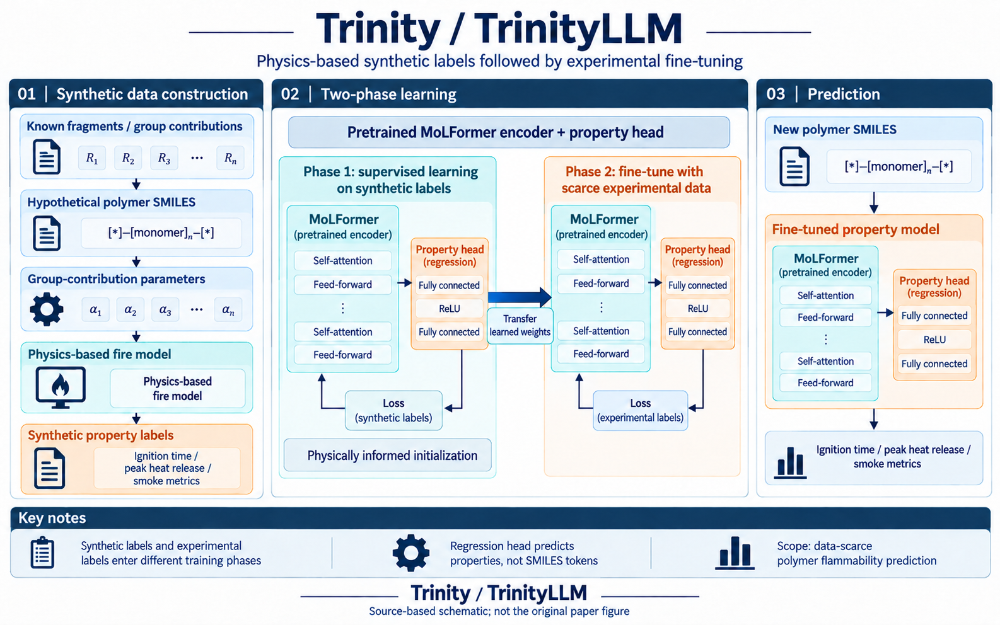

论文：[Harnessing large language models for data-scarce learning of polymer properties](https://www.nature.com/articles/s43588-025-00768-y)

依据：本地 `Trinity_2024_preprint.pdf`，PDF 第 2, 3, 7, 8 页。

区分物理模型生成合成标签、第一阶段监督预训练和第二阶段实验标签微调；输出 head 是性质回归，不是 token decoder。依据本地 2024 预印本。


## MHG-GNN

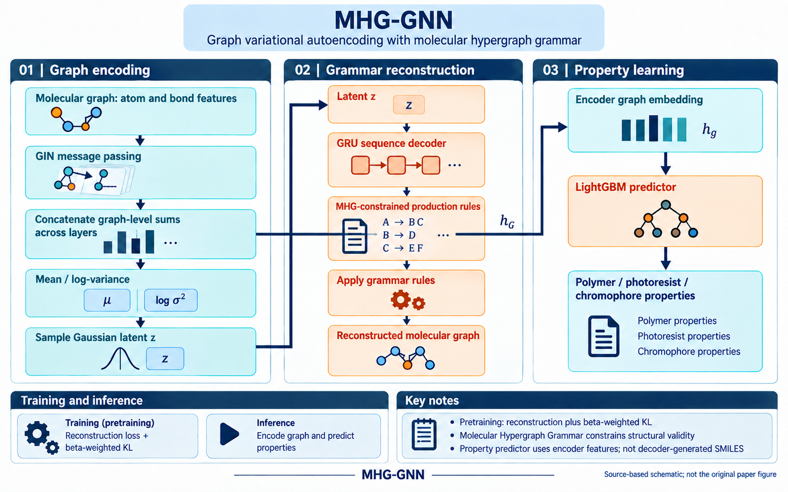

论文：[MHG-GNN: Combination of Molecular Hypergraph Grammar with Graph Neural Network](https://arxiv.org/abs/2309.16374)

依据：本地 `MHG-GNN_2023_preprint.pdf`，PDF 第 2, 3, 4, 6 页。

GIN graph embedding 接 Gaussian latent 与 MHG-GRU 解码；性质预测单独使用 LightGBM。


## Polymer-JEPA

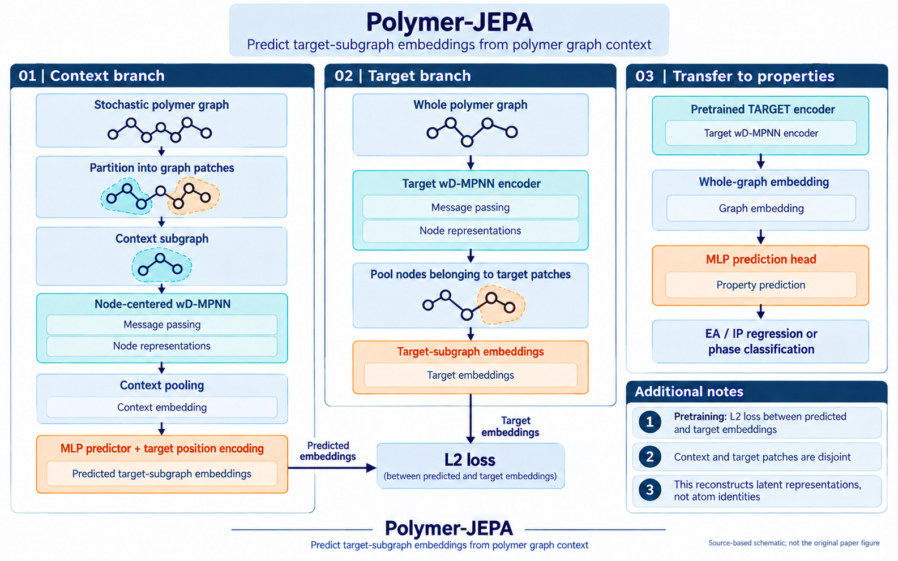

论文：[Joint embedding predictive architecture for self-supervised pretraining on polymer molecular graphs](https://pubs.rsc.org/en/content/articlelanding/2026/dd/d5dd00308c)

依据：本地 `Polymer-JEPA_2025_preprint.pdf`，PDF 第 5, 6, 7 页。

target encoder 读取整图再池化目标子图节点；predictor 使用 context 与位置编码。下游复用 target encoder；未加入未经本地版本确认的 EMA/stop-gradient 细节。


## MMPolymer

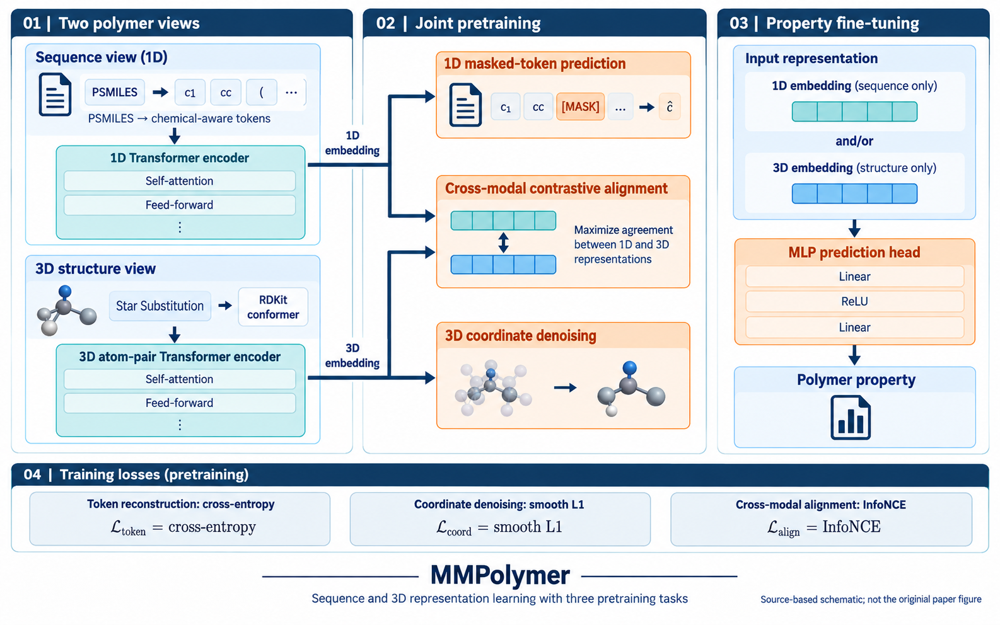

论文：[MMPolymer: A Multimodal Multitask Pretraining Framework for Polymer Property Prediction](https://arxiv.org/abs/2406.04727)

依据：本地 `MMPolymer_2024_preprint.pdf`，PDF 第 2, 3, 4, 5 页。

并行序列与原子-对 3D Transformer，三种目标分别是 token CE、坐标 smooth L1、InfoNCE。不照搬原图中简化的 SE(3)-Transformer 架构标签。


## PolyNC

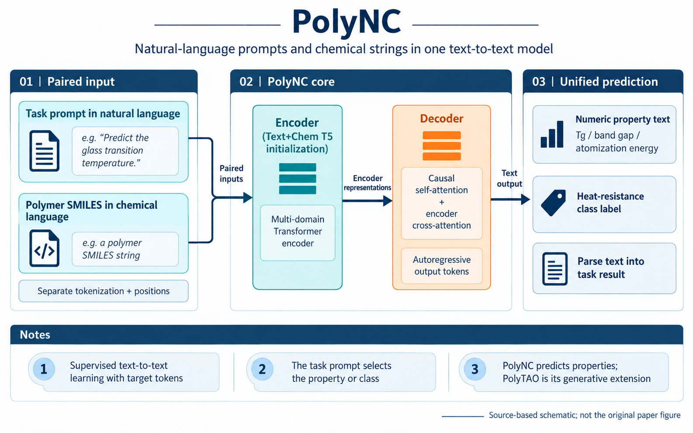

论文：[PolyNC: a natural and chemical language model for the prediction of unified polymer properties](https://pubs.rsc.org/en/content/articlelanding/2024/sc/d3sc05079c)

依据：本地 `PolyNC_2024_published_pmc_copy.pdf`，PDF 第 3, 8, 9 页。

task prompt 与 SMILES 两种语言输入，T5 encoder-decoder 将性质或类别输出为文本；不同于 PolyTAO 逆向生成。


## MIPS

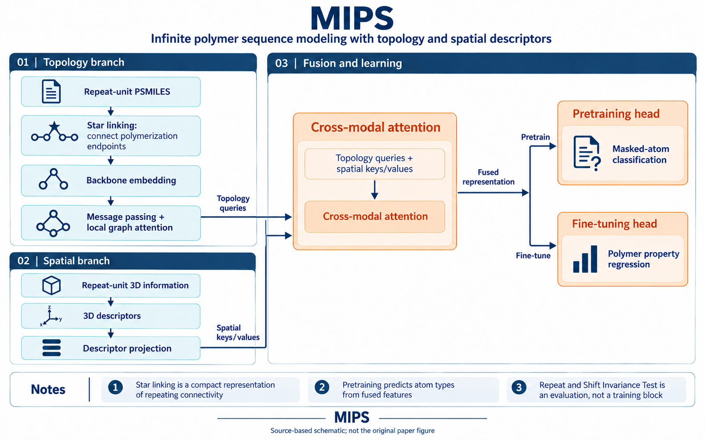

论文：[MIPS: a Multimodal Infinite Polymer Sequence Pre-training Framework for Polymer Property Prediction](https://arxiv.org/abs/2507.20326)

依据：本地 `MIPS_2025_preprint.pdf`，PDF 第 2, 4, 5, 6 页。

star linking 与 backbone embedding 编码重复拓扑；3D descriptors 经 projection 与拓扑分支 cross-attention 融合；训练 masked atoms。


## PolyLLMem

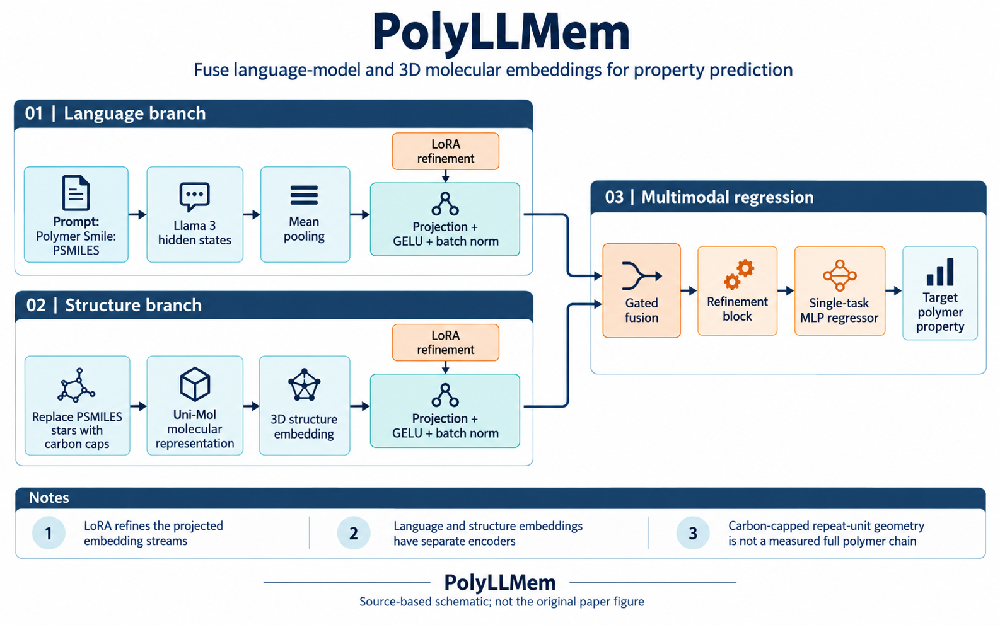

论文：[Multimodal machine learning with large language embedding model for polymer property prediction](https://arxiv.org/abs/2503.22962)

依据：本地 `PolyLLMem_2025_preprint.pdf`，PDF 第 6, 7, 8 页。

Llama 3 mean pooling 与碳封端输入的 Uni-Mol 嵌入各自投影，LoRA 用于投影/嵌入细化；gated fusion 后单任务 MLP 回归。


## STR-Bamba

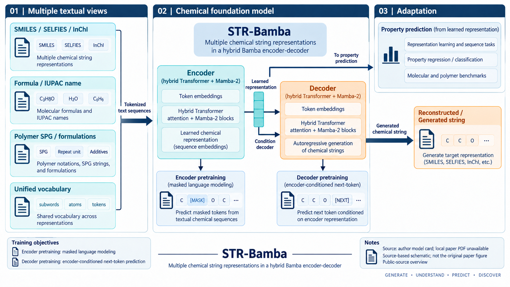

论文：[STR-Bamba: Multimodal Molecular Textual Representation Encoder-Decoder Foundation Model](https://openreview.net/pdf?id=0uWNuJ1xtz)

依据：作者公开资料概要；本地全文缺失，未确认的层数、参数和细节没有加入图中。

补充依据：[作者来源](https://huggingface.co/ibm-research/materials.str-bamba)

补充依据：[作者来源](https://github.com/IBM/materials/tree/main/models/str_bamba)

依据作者模型卡中的多字符串统一词表与 Transformer/Mamba-2 混合 encoder-decoder，绘制概要；无本地 PDF，不臆造层排列。作者模型卡还确认 encoder 用 MLM、decoder 用 encoder-conditioned next-token prediction，图中分开表示。


## Uni-Poly

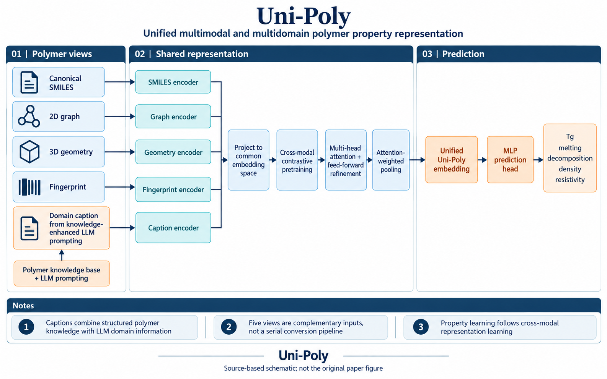

论文：[Unified multimodal multidomain polymer representation for property prediction](https://www.nature.com/articles/s41524-025-01652-z)

依据：本地 `Uni-Poly_2025_published.pdf`，PDF 第 7, 8, 9 页。

SMILES、图、几何、指纹、领域 caption 五个并行模态；投影对齐、注意力细化、加权池化、MLP 预测。


## PolyRL

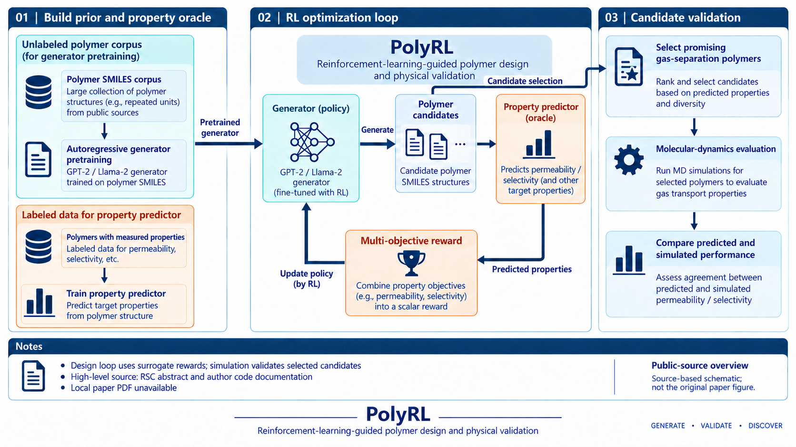

论文：[PolyRL: reinforcement learning-guided polymer generation for multi-objective polymer discovery](https://pubs.rsc.org/en/content/articlelanding/2026/dd/d5dd00272a)

依据：作者公开资料概要；本地全文缺失，未确认的层数、参数和细节没有加入图中。

补充依据：[作者来源](https://pubs.rsc.org/en/content/articlelanding/2026/dd/d5dd00272a)

补充依据：[作者来源](https://github.com/Knitua/PolyRL)

基于作者公开说明绘制生成器/独立性质 oracle/RL reward loop/候选 MD 验证；无本地 PDF，不断言唯一 RL 算法或所有候选均已模拟。


## PolyTAO


论文：[On-demand reverse design of polymers with PolyTAO](https://www.nature.com/articles/s41524-024-01466-5)

依据：本地 `PolyTAO.pdf`，PDF 第 3, 7, 8 页。

复用 PolymerGeneration 中的原图，不重新生成。


## DemoDiff

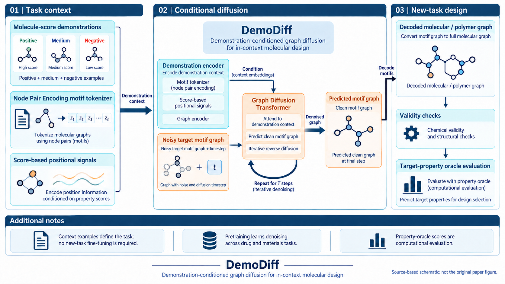

论文：[Graph Diffusion Transformers are In-Context Molecular Designers](https://arxiv.org/abs/2510.08744)

依据：本地 `DemoDiff_2025_preprint.pdf`，PDF 第 3, 4, 5, 6 页。

molecule-score demonstrations 是 context，noisy target motif graph 是另一输入；NPE motif tokenizer 和 Graph DiT 反向扩散；任务适应靠 context 而不是新任务微调。


## CoMole

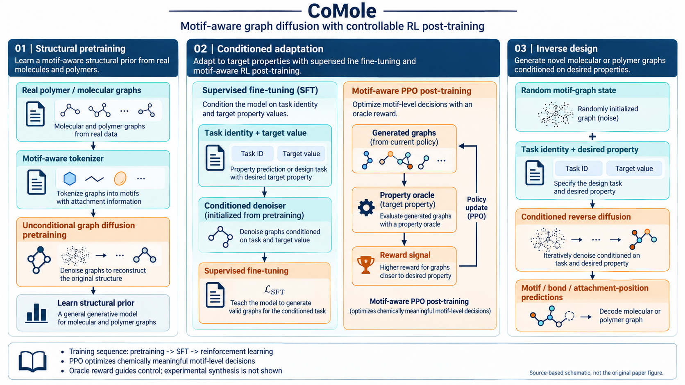

论文：[Controllable Molecular Generative Foundation Models](https://arxiv.org/abs/2605.15354)

依据：本地 `CoMole_2026_preprint.pdf`，PDF 第 3, 4, 5, 13, 14 页。

pretraining、SFT、motif-aware PPO 三阶段；task identity 与目标值条件化；property-oracle 终态 reward 反馈策略。


## polyBART

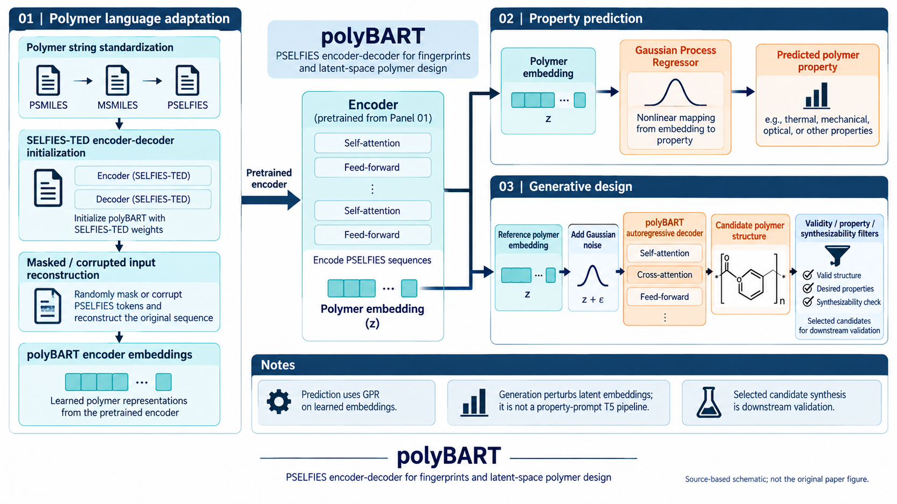

论文：[polyBART: A Chemical Linguist for Polymer Property Prediction and Generative Design](https://aclanthology.org/2025.findings-emnlp.647/)

依据：本地 `polyBART_2025_published.pdf`，PDF 第 3, 4, 5, 6 页。

性质分支为 encoder embeddings -> GPR，设计分支为 reference embeddings + Gaussian noise -> decoder -> 筛选；不画成属性提示直接条件生成。


## POLYT5


论文：[POLYT5: an encoder-decoder foundation chemical language model for generative polymer design](https://www.nature.com/articles/s44387-026-00087-1)

依据：本地 `POLYT5.pdf`，PDF 第 2, 3, 8, 9 页。

复用 PolymerGeneration 中的原图，不重新生成。


## PolyConFM

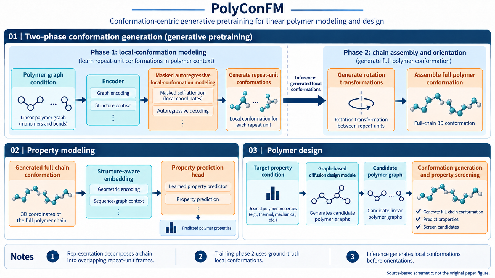

论文：[Unifying Polymer Modeling and Design via a Conformation-Centric Generative Foundation Model](https://arxiv.org/abs/2510.16023)

依据：本地 `PolyConFM_2025_preprint.pdf`，PDF 第 3, 4, 11, 12, 13, 14 页。

先按 graph condition 生成局部 repeating-unit conformations，再生成 rotation transformations 并组装整链；下游性质建模与 graph diffusion 设计共享构象生成/筛选流程。


## Llamole

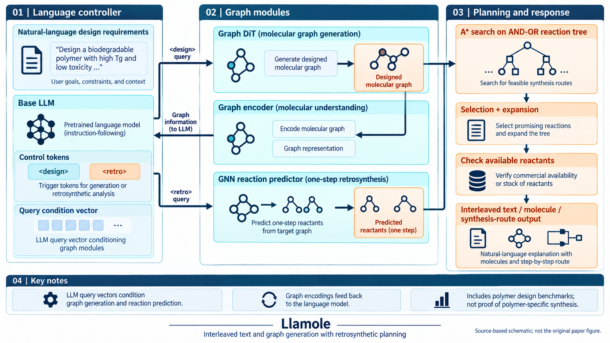

论文：[Multimodal Large Language Models for Inverse Molecular Design with Retrosynthetic Planning](https://arxiv.org/abs/2410.04223)

依据：本地 `Llamole_2025_conference_author_copy.pdf`，PDF 第 3, 4, 5, 6 页。

`<design>` 和 `<retro>` 各自路由到 Graph DiT 与 reaction predictor；`<query>` 条件、graph encoder 反馈和 A* AND-OR planning；不是三个图模块串行。

## 维护

新增或修改图前，先按模型 ID 检查结构规格、生成清单和现有 PNG，避免重复生成。
确认修改后更新来源、检查记录和 SHA-256，再运行：

```sh
python3 scripts/build_architecture_index.py
python3 scripts/build_catalog.py
```
